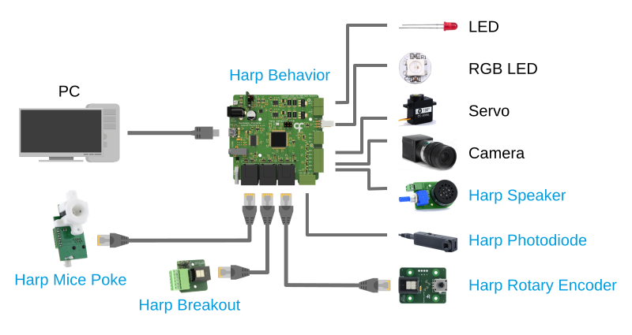

# Harp Behavior

The Harp Behavior device is a multi-purpose data acquisition and control system for behavioral neuroscience experiments. It controls mice pokes, LEDs, RGB LEDs, cameras and servo motors, reads digital, analog and quadrature encoder inputs, and timestamps every input and output on the same hardware clock.

## Documentation

The [device documentation](https://harp-tech.org/device.behavior) covers the specifications, setting up the device, installing the software, examples for each feature, and the register reference.

## Software

The device can be used from [Bonsai](https://bonsai-rx.org/) through the `Harp.Behavior` package, from Python through the `harp-behavior` package, or without programming through the Behavior app. The [installation](https://harp-tech.org/device.behavior/articles/installation.html) page describes how to install each of them.

## Repository layout

- `device.yml` describes the registers of the device. The firmware headers and the .NET and Python interfaces are generated from it.
- `firmware` holds the firmware of the device.
- `hardware` holds the PCB and mechanical design files.
- `software` holds the .NET packages, including the Bonsai package and the app, and the Python package.
- `docs` holds the documentation site.

## Licensing

Each part of this repository is released under its own license. The `LICENSE` file at the root of the repository lists the licenses that apply to each folder.
