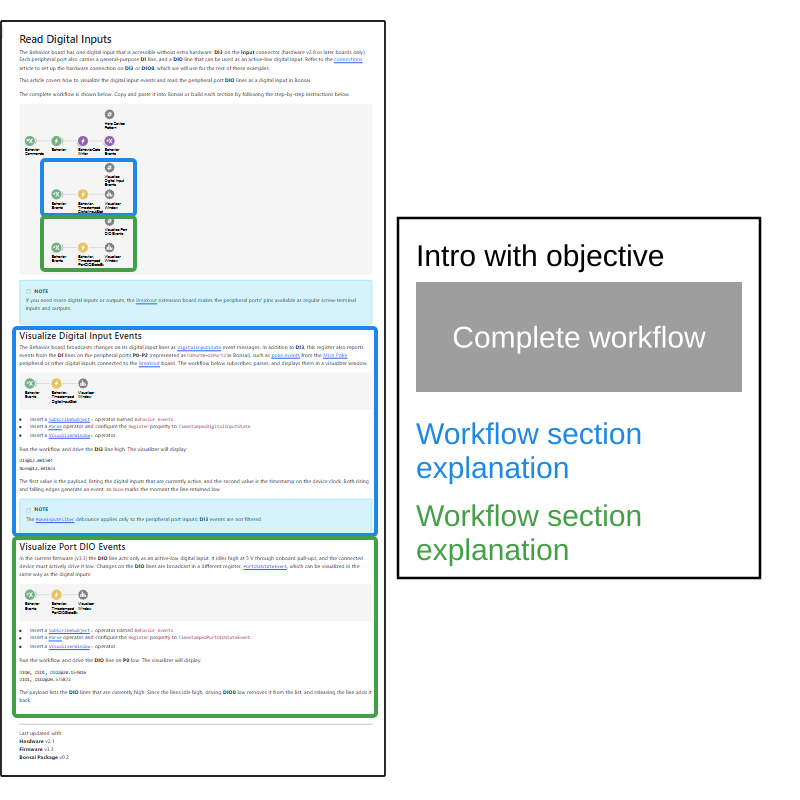
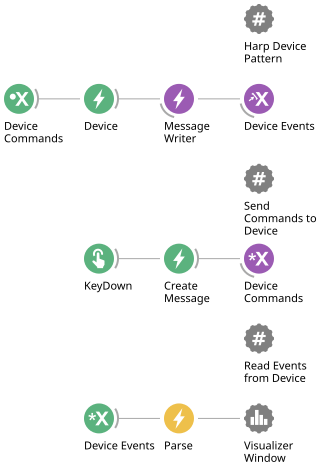

## About These Examples

The following articles cover how to operate the device in Bonsai. Each article walks through either a specific function of the device or a set of input/output ports. This guide explains the article layout as well as the building blocks that are used in the Bonsai workflows.

### Article Layout

:::wrap-left
{width=400}
:::

Every article begins with an introduction to the specific functionality. If an example requires specific hardware connections, there is a link to the relevant connection instructions.

The introduction is followed by a complete top-level workflow that you can copy and paste into Bonsai to get started immediately. Annotation nodes (the # symbol) divide the workflow into one or more **sections**, each with a title describing what that part of the workflow does. 

The rest of the article then explains the workflow one section at a time, with each section heading having the same title as the annotation. Each section explains what that part of the workflow does, which registers it uses, and how to build each section with step-by-step instructions.

### Building Blocks

Within a section, each chain of connected operators is a **block**. A section contains one or more blocks, and every block is one of three types:



- A **device pattern** block that sets up the device, always the first section of the workflow. As it is identical across all the workflows, it does not have a separate section explanation. 
- A **send commands** block that sends a command to the device.
- A **read events** block that reads events from the device.

The rest of this article explains the three block types. The figures use the generic operators from the `Bonsai.Harp` package so the pattern applies to any Harp device.

> [!NOTE]
> You can find and add these operators to the workflow from the Bonsai [Toolbox](https://bonsai-rx.org/docs/articles/editor.html?tabs=mouse-controls#toolbox). When following the examples in the later articles, make sure to use the device-specific versions, e.g. `Device (Harp.Behavior)` from the `Harp.Behavior` package instead of the generic `Device (Harp)` operator or another device's version. Operators from different packages share the same name. If correctly selected, the names of these operators in the workflow panel change to reflect the device name.

#### Device Pattern

The [Harp device pattern](https://harp-tech.org/articles/operators.html#device-pattern) is the first section of every workflow. It initializes the device, logs data, and provides hooks to send commands as well as receive messages from a Harp device according to the Harp [communication protocol](https://harp-tech.org/protocol/BinaryProtocol-8bit.html).


The block is made up of:

- A [`BehaviorSubject`] operator named `Device Commands` that collects every command sent to it from elsewhere in the workflow and forwards them to the device.
- A [`Device`] operator that establishes the serial communication link with the device.
- A [`MessageWriter`] operator that logs the messages from the device to a file. The device-specific package provides a dedicated [`DeviceDataWriter`] named after the device.
- A [`PublishSubject`] operator that broadcasts the message stream as a `Device Events` subject.

#### Send Commands

A send commands block needs a trigger. There are different ways to trigger commands, but in these articles the examples use keyboard keys as the trigger.


The block is made up of:

- A [`KeyDown`] operator that triggers the block to execute each time you press the key set in its `Filter` property.
- A [`CreateMessage`] operator that builds the command to send to the device.
- A [`MulticastSubject`] operator that sends the command to the `Device Commands` subject.

> [!NOTE]
> In a real experiment, control logic in Bonsai takes the place of the key presses. For instance, a [`Timer`] can replace [`KeyDown`] to send the command at a set time after the workflow starts.

#### Read Events

A read events block subscribes to the messages from the device, selects the ones it needs, and decodes them for display.


The block is made up of:

- A [`SubscribeSubject`] operator that subscribes to the `Device Events` message stream.
- A [`Parse`] operator that picks out the messages corresponding to one register and decodes its values.
- A [`VisualizerWindow`] operator that opens a window and displays the decoded values when the workflow starts.

Article sections that read events also include a text sample of the visualizer output, with a description of what the values mean:

```text
13@10.351072
```

### Additional Resources

For more, see:

- The [`Bonsai.Harp`](https://harp-tech.org/articles/operators.html) interface package documentation to learn more about Harp operators.
- The [Harp website](https://harp-tech.org/protocol/BinaryProtocol-8bit.html) for more information on how Harp devices communicate.
- The [Bonsai documentation](https://bonsai-rx.org/docs/) to learn more about Bonsai control logic.

[!INCLUDE [](version-footer.md)]

<!--Reference Style Links -->
[`BehaviorSubject`]: xref:Bonsai.Reactive.BehaviorSubject
[`CreateMessage`]: xref:Bonsai.Harp.CreateMessage
[`Device`]: xref:Bonsai.Harp.Device
[`DeviceDataWriter`]: xref:Harp.Behavior.DeviceDataWriter
[`KeyDown`]: xref:Bonsai.Windows.Input.KeyDown
[`MessageWriter`]: xref:Bonsai.Harp.MessageWriter
[`MulticastSubject`]: xref:Bonsai.Expressions.MulticastSubject
[`Parse`]: xref:Bonsai.Harp.Parse
[`PublishSubject`]: xref:Bonsai.Reactive.PublishSubject
[`SubscribeSubject`]: xref:Bonsai.Expressions.SubscribeSubject
[`Timer`]: xref:Bonsai.Reactive.Timer
[`VisualizerWindow`]: xref:Bonsai.Design.VisualizerWindow
