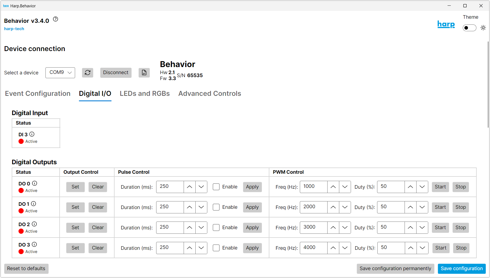

# Behavior app

The Behavior app is a desktop app for configuring and testing the device without using Bonsai.

Before beginning:
- Install the [Behavior app](installation.md?tabs=app#software-packages).
- Follow the hardware setup [guide](ports-connections.md).
- Connect the [USB](ports-connections.md) cable to the computer.
- Launch the Behavior app by running `harp.behavior` in a terminal.

1. Select the port for the device, and press "Connect". The device details will display on the right side if it is successfully connected.
2. Select the tab for the register group that you want to control.
3. Change the values to test outputs, LEDs, cameras, and servos, and observe the output on the connected peripherals.

If an error appears in the Behavior app, check out the [troubleshooting](errors.md) section.

[!INCLUDE ]
