## Ports and Connections

This article covers the ports on the Behavior board, as well as how to connect the device to peripherals and external devices.

### Ports

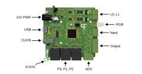{width=600}

**12V PWR (Barrel Jack)** - This port powers the Behavior board and requires a 12 V power supply.

**USB (USB-C)** - This port connects the device to the control computer running [Bonsai](harp-bonsai.md) or the [GUI](./behavior-gui.md).

**CLKIN (Stereo Jack)** - This [Harp](https://harp-tech.org/articles/about.html) clock input accepts a clock output from any compatible Harp clock generator or synchronizer (e.g. [Harp Timestamp Generator](https://github.com/harp-tech/device.timestampgeneratorgen3)) for synchronization with other connected devices.

**STATE** - This status LED cycles on and off with a period of:
- 2 seconds when it's communicating with Bonsai
- 4 seconds when in standby
- 100 milliseconds when a catastrophic error occurs

**P0, P1, P2 (RJ45)** - These poke ports interface directly with the [Mice Poke](./peripherals/peripherals-micepoke.md) peripheral for poke detection and reward delivery. Alternatively, use the [Breakout](./peripherals/peripherals-portbreakout.md) extension board to interface with other accessories. Port **P2** also has a quadrature counter for [rotation tracking](track-rotary-encoder.md). Use it with the [Rotary Encoder](./peripherals/peripherals-rotaryencoder.md) peripheral, or with a quadrature encoder connected through the Breakout extension board.

**ADC (Screw Terminal)** - This connector carries the first analog input (**AD0**), a 5 V supply pin and two ground connections.

**Output (Screw Terminal)** - These general-purpose 5 V digital outputs can be used to communicate with external devices. **DO0**/**DO1** can generate [camera triggers](trigger-cameras.md) and **DO2**/**DO3** can drive [servo motors](drive-servos.md); all four support [PWM](generate-pwm.md).

**Input (Screw Terminal)** - This connector carries the second analog input (**AD1**), the digital input **DI3** and one ground connection.

**RGB (3-pin Flick Lock)** - Connector for up to two  addressable RGB LEDs (WS2812-type, e.g., NeoPixels). The LEDs are driven as a serial chain on a single data line, with colors set with the [RGB registers](control-leds.md#set-rgb-colors).

**L0, L1 (Screw Terminal)** - These connectors control two single-color conventional LED outputs. Each terminal pair is marked **A** (anode, the LED's long leg) and **K** (cathode, the short leg). The drive current is [configurable](control-leds.md) from 2 to 100 mA.

### Connections

# [Analog Input](#tab/analoginput)

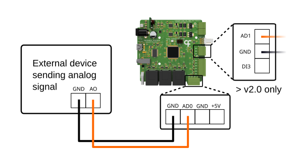{width=600}

1. Wire the analog signal (0–5 V) to either **AD0** on the **ADC** connector or **AD1** on the **Input** connector.
2. Connect the ground wire to any **GND** pin.
3. Refer to the [Acquire Analog Data](acquire-analog-data.md) article to read the signal in Bonsai.

# [Digital Input](#tab/digitalinput)

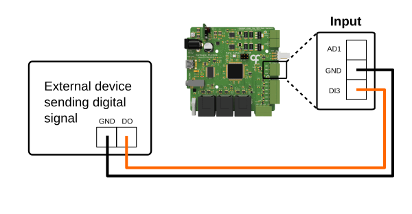{width=600}

1. Wire the digital signal (5 V) to **DI3** on the **Input** connector. Alternatively, use the [Breakout](./peripherals/peripherals-portbreakout.md) board to unlock more digital inputs on the poke ports.
2. Connect the ground wire to any **GND** pin.
3. Refer to the [Read Digital Inputs](read-digital-inputs.md) article to visualize the input events in Bonsai.

# [Digital Output](#tab/digitaloutput)

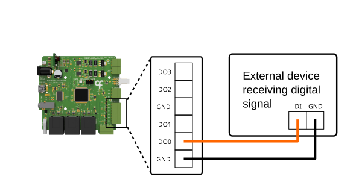{width=600}

1. Wire a digital output from **DO0**–**DO3** on the **Output** connector to the external device's digital input. Alternatively, use the [Breakout](./peripherals/peripherals-portbreakout.md) board to unlock more digital outputs on the poke ports.
2. Connect the external device's ground to any **GND** pin.
3. Refer to the [Control Digital Outputs](control-digital-outputs.md) article to switch the output in Bonsai.

# [Photodiode](#tab/photodiode)

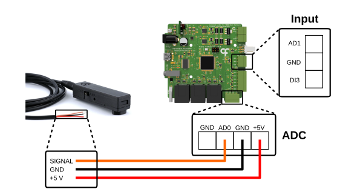{width=600}

Before connecting the [Photodiode](./peripherals/peripherals-photodiode.md) peripheral, switch the jumper setting on the casing to either **ANA** for an analog reading or **DIG** for a digital output. Plug the stereo adapter cable into the stereo jack on the peripheral. The other end of the cable has three colored wires for the signal, 5 V supply and ground.

For an analog reading:

1. Wire the signal wire to either **AD0** on the **ADC** connector or **AD1** on the **Input** connector.
2. Connect the ground wire to any **GND** pin.
3. Wire the supply wire to the **+5V** pin on the **ADC** connector.
4. Refer to the [Acquire Analog Data](acquire-analog-data.md) article to read the light intensity as an analog reading in Bonsai.

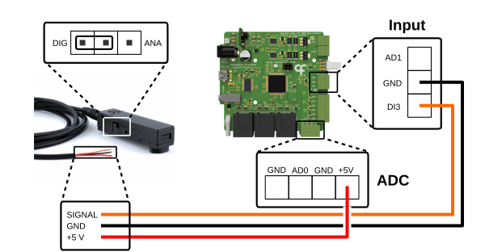{width=600}

For a digital output:

1. Wire the signal wire to **DI3** on the **Input** connector. Alternatively, use the [Breakout](./peripherals/peripherals-portbreakout.md) board to unlock more digital inputs on the poke ports.
2. Connect the ground wire to any **GND** pin.
3. Wire the supply wire to the **+5V** pin on the **ADC** connector.
4. Refer to the [Read Digital Inputs](./read-digital-inputs.md) article to read the light intensity as a digital input reading in Bonsai.
5. Turn the adjustment screw to tune the light threshold for the low and high state of the digital output and monitor the response in Bonsai.

>[!NOTE]
> Third-party photodiode modules that are powered with 5 V and output a 0 to 5 V signal can be wired the same way.

# [Speaker](#tab/speaker)

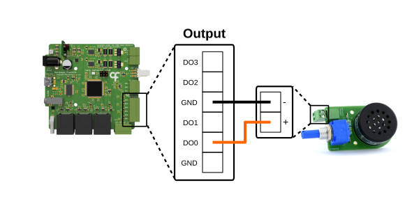{width=600}

1. Wire the **+** terminal of the [Speaker](./peripherals/peripherals-speaker.md) peripheral to one of **DO0**–**DO3** on the **Output** connector.
2. Wire the **-** terminal to any **GND** pin.
3. Refer to the [Generate PWM](generate-pwm.md) article to play tones in Bonsai.

>[!NOTE]
> Third-party passive buzzers or speakers can be driven with PWM in the same way. Active buzzers generate a fixed tone, so switch them on and off like any other digital output (see [Control Digital Outputs](control-digital-outputs.md)). Add a current-limiting series resistor (100 to 330 Ω) to avoid overloading the 5 V supply.

# [LED](#tab/led)

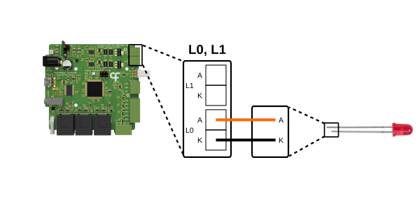{width=600}

1. Wire the long leg (anode) of a conventional LED to the **A** pin of either the **L0** or **L1** terminal pair. No series resistor is needed as the drive current can be set in Bonsai.
2. Wire the short leg (cathode) to the **K** pin of the same terminal pair.
3. Refer to the [Control LEDs](control-leds.md) article to configure and switch the LEDs in Bonsai.

# [RGB LED](#tab/rgbled)

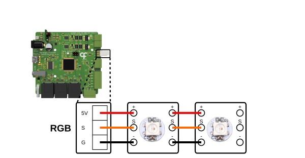{width=600}

1. Connect the signal wire of an addressable RGB LED to **S** on the **RGB** connector. Analog RGB LEDs are not supported.
2. Connect its ground wire to **G**.
3. Connect its power wire to **5V**.
4. Up to two RGB LEDs can be driven. Connect the second one as a serial chain with the same wiring configuration.
5. Refer to the [Control LEDs](control-leds.md#set-rgb-colors) article to set the colors and switch the RGB LEDs in Bonsai.

# [Mice Poke](#tab/poke)

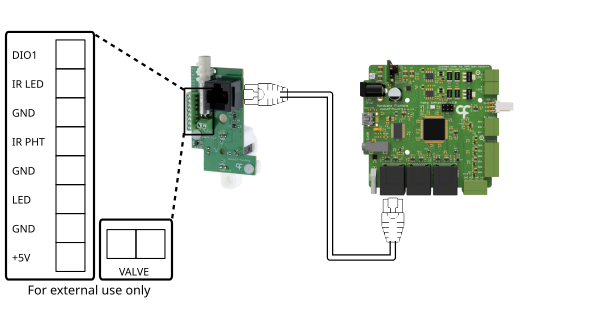{width=600}

1. Connect the [Mice Poke](./peripherals/peripherals-micepoke.md) peripheral to port **P0**, **P1**, or **P2** with an RJ45 cable.
2. If the peripheral comes with an integrated water valve, connect the valve's inlet to the liquid container with tubing (2.0 mm inner diameter FEP, or 2.1 mm PTFE).
3. Refer to the [Control Poke Peripheral](control-poke.md) article to configure and use the Mice Poke peripheral in Bonsai.

No further wiring is necessary. The screw terminal blocks are only needed for external use; they share the same connections that are carried by the RJ45 connector.
Use them to connect an extra sensor, wire a different solenoid valve, or log the peripheral signals.

To add a sensor like a lever:

1. Wire one contact of the lever switch to **GND** and the other to **DIO1**. This line is not connected to any of the peripheral sensors and acts as an active-low digital input (the functionality to toggle it to digital output has not been added yet).
2. Refer to the [Read Digital Inputs](read-digital-inputs.md#visualize-port-dio-events) article to read the signal in Bonsai.

To use an alternative solenoid valve for reward delivery:

1. If the peripheral comes with an integrated valve, disconnect the integrated valve's leads from the **VALVE** terminal.
2. Wire a 12 V solenoid valve across the terminal pair. For standard coil-only solenoid valves, polarity does not matter.

To log the peripheral signals on an external device:

1. Wire the signals (5 V logic) to digital inputs on the external device:
    - **IR LED** - Reports the status of the beam LED emitter.
    - **IR PHT** - Reports the status of the infrared photodetector.
    - **LED** - Reports the status of the [onboard cue LEDs](control-poke.md#drive-the-poke-led).
2. Share ground between the external device and any **GND** terminal.

# [Rotary Encoder](#tab/encoder)

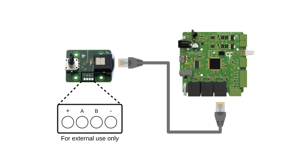{width=600}

1. Connect the [Rotary Encoder](./peripherals/peripherals-rotaryencoder.md) peripheral to port **P2** with an RJ45 cable. This is the only port with the quadrature counter functionality.
2. Refer to the [Track Rotary Encoder](track-rotary-encoder.md) article to read the encoder in Bonsai. 

No further wiring is necessary to use the device with the Behavior board. The solder pads are only needed to access the raw quadrature signals for logging.

To log the raw quadrature signals:

1. Wire the **A** and **B** quadrature signals (5 V logic) to digital inputs on the external device.
2. Share ground between the external device and the **-** pad.

To connect an external rotary encoder, we recommend using the [Breakout](./peripherals/peripherals-portbreakout.md) board instead for an easier connection. Refer to the Breakout tab for more information.

# [Camera](#tab/camera)

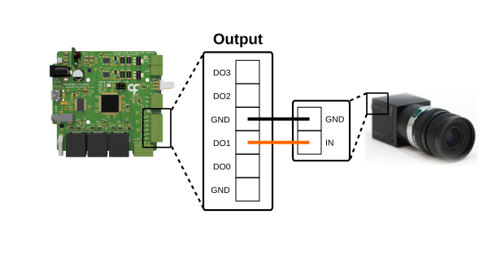{width=600}

1. Locate the GPIO (general purpose input/output) connector on your camera. Refer to the camera manual for the connector pinout as it varies widely between camera models and manufacturers.
2. Check that the camera input is compatible with the 5 V trigger signal from the Behavior board. For cameras with lower-voltage trigger inputs (e.g. 1.8 V or 3.3 V logic), add a level shifter between the output and the camera.
3. Using the camera vendor's software, configure the camera to use the digital input line corresponding to the input pin you selected. Set the image capture mode to use the rising edges of the incoming pulse to trigger each frame capture.
4. Wire the camera's external trigger input to **DO0** or **DO1** on the **Output** connector. These are the only ports that support the camera trigger functionality. 
5. Connect the camera's trigger ground to any **GND** pin.
6. Refer to the [Trigger Cameras](trigger-cameras.md) article to configure and start the trigger in Bonsai.

# [Servo](#tab/servo)

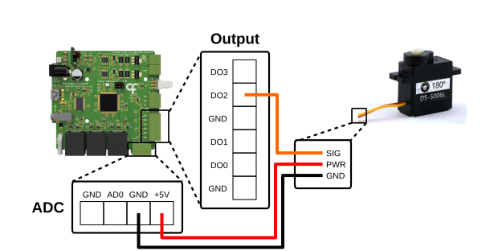{width=600}

1. Connect the servo signal wire to **DO2** or **DO3** on the **Output** connector. These are the only ports that support the servo functionality.
2. Connect the servo power wire to the **+5V** pin on the **ADC** connector. Alternatively, use the [Breakout](./peripherals/peripherals-portbreakout.md) board to unlock more power pins on the poke ports. For servos that draw more than 200 mA, or that require a supply voltage other than 5 V, power the servo from an external supply matching its rating instead. Never connect the external supply to the board's 5 V pin; it must power the servo only.
3. Connect the servo ground wire to a **GND** pin. For servos requiring an external power supply, connect the external supply's ground to a **GND** pin.
4. Refer to the [Drive Servos](drive-servos.md) article to move the servo in Bonsai.

# [Breakout](#tab/breakout)

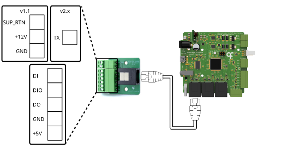{width=600}

Both versions of the [Breakout](./peripherals/peripherals-portbreakout.md) board are shown above. Follow the instructions for the version you have, some of the functionality is only available for a specific version.

To connect digital inputs and outputs (both v1.1 and v2.x):
1. Connect the Breakout board to port **P0**, **P1**, or **P2** with an RJ45 cable.
2. Wire the signal wire from external devices to the **DI**, **DIO**, and **DO** screw terminals.
3. Wire the external device's ground to a **GND** terminal.
4. If the external device needs power, wire its supply to the **+5V** terminal.
5. Refer to the [Read Digital Inputs](read-digital-inputs.md) and [Control Digital Outputs](control-digital-outputs.md) articles to use these lines in Bonsai.

To connect an external quadrature encoder (both v1.1 and v2.x):
1. Connect the Breakout board to port **P2** with an RJ45 cable. The quadrature counter is only available on this port.
2. Wire the encoder's **A** channel to the **DI** terminal. Both channels must be 5 V logic.
3. Wire the encoder's **B** channel to the **DIO** terminal.
4. Wire the encoder's ground to a **GND** terminal.
5. Wire the encoder's supply to the **+5V** terminal. For encoders that require a different supply voltage, power the encoder from an external supply instead and share only its ground with the **GND** terminal.
6. Leave any index (**Z**) output of the encoder unconnected as the Behavior board does not support it.
7. Refer to the [Track Rotary Encoder](track-rotary-encoder.md) article to read the encoder in Bonsai. If the count runs in the opposite direction to the rotation, swap the **A** and **B** wires.

To control valves for reward delivery (v1.1 only):
1. Connect the [Breakout](./peripherals/peripherals-portbreakout.md) board to port **P0**, **P1**, or **P2** with an RJ45 cable.
2. Wire a 12 V solenoid valve between the **+12V** and **SUP_RTN** terminals.
3. Refer to [Deliver Rewards on Poke](control-poke.md#deliver-rewards-on-poke) to pulse the valve line in Bonsai.

To stream the serial timestamp (v2.x only):
1. Connect the board to **P2**, the timestamp stream can only be transmitted on this port.
2. Wire the **TX** terminal to the receiving device's **RX** input or to a logged digital input.
3. Wire a **GND** terminal to the receiver's ground.
4. Set the board's logic-level jumper to match the receiver's operating voltage level (3.3 V or 5 V).
5. Refer to the [Stream Timestamps](advanced-configuration.md#stream-timestamps) section to enable the stream in Bonsai.

# [Harp Synchronization](#tab/harpsynchronization)

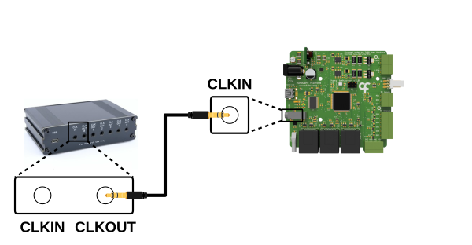{width=600}

1. Connect a **CLKOUT** of a Harp clock generator (e.g. the [Harp Timestamp Generator](https://github.com/harp-tech/device.timestampgeneratorgen3)) to the **CLKIN** jack with a stereo plug cable.
2. The Behavior board adopts the generator's clock automatically. To verify the connection, check that the **STATE** LEDs of the connected boards blink simultaneously.
3. Refer to the [Harp synchronization clock](https://harp-tech.org/protocol/SynchronizationClock.html) documentation for how devices synchronize.

---

[!INCLUDE ]
