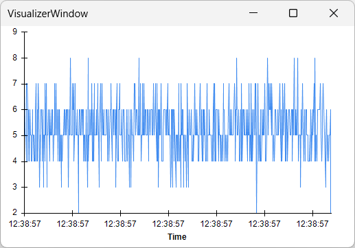

# Bonsai

Bonsai is a visual reactive programming language for building interactive experiments and processing data streams in real time. It supports a growing ecosystem of hardware and software packages that are commonly used in neuroscience. This article covers how to set up the Behavior board in Bonsai.

> [!TIP]
> More information on Bonsai can be found in the official [documentation](https://bonsai-rx.org/docs/).

## First steps

We will use an introductory example to get started with the device in Bonsai. This example plots one channel of the analog input stream from the Behavior board. You do not need to connect an analog input device. We revisit this example in more detail in the "Examples" section.

Before beginning:
- Connect the [USB](connections.md) cable to the computer.
- Launch "Bonsai" from the Windows Start menu.
- Hover over the workflow cell below, and click on the "Copy" icon on the top right.
- Paste the workflow into Bonsai.

:::workflow

:::

> [!TIP]
> If your workflow does not look like the one above, make sure that the [Harp.Behavior and Bonsai.StarterPack](./installation.md#software-packages) packages are installed.

- Click on the [`Behavior (Device)`] operator and set the `PortName` property to the communications port for the device (e.g. COM8).
- Click on the [`BehaviorDataWriter (DeviceDataWriter)`] operator and set the `Path` property for the name and location of the save folder (e.g. `Behavior.harp`).
- Press the "Start" button in Bonsai to run the workflow.

A [visualizer](xref:Bonsai.Design.VisualizerWindow) will automatically open when the workflow starts, displaying a time-series plot of the `AnalogInput0` channel.

{width=300}

The device is ready to use! If, instead, an error appears in Bonsai, check out the [troubleshooting](troubleshooting.md) section.

Next, we suggest going through the "Examples" section if you are not familiar with using Harp devices in Bonsai.

Alternatively, if you have experience with Harp devices, you can check the [register table](xref:Harp.Behavior) in the reference to access the device functionality directly.

[!INCLUDE ]

<!--Reference Style Links -->
[`Behavior (Device)`]: xref:Harp.Behavior.Device
[`BehaviorDataWriter (DeviceDataWriter)`]: xref:Harp.Behavior.DeviceDataWriter
[`AnalogData`]: xref:Harp.Behavior.AnalogData
