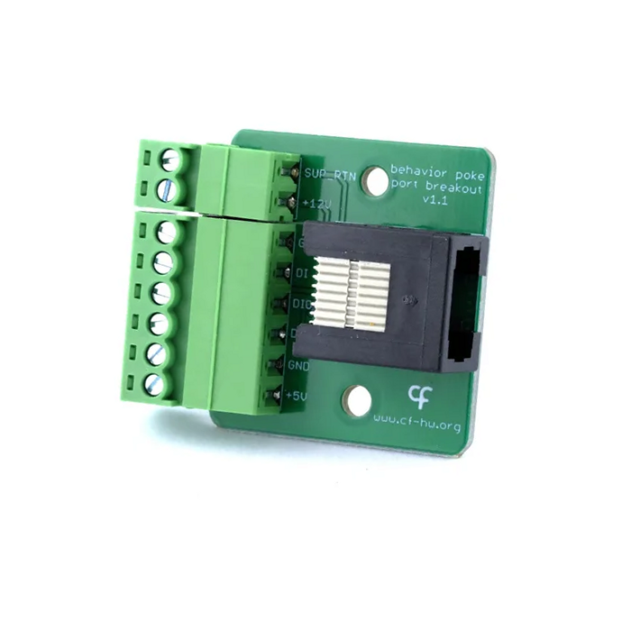
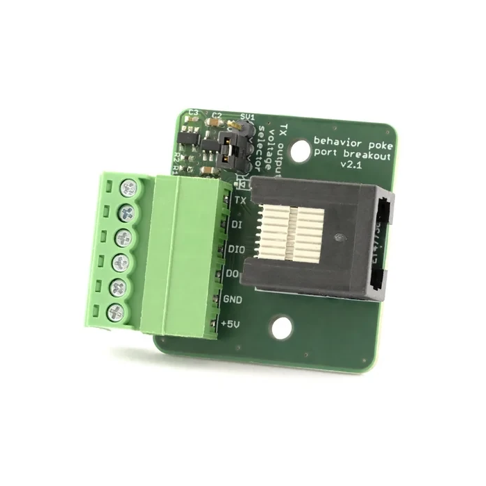

# Breakout

The Harp Behavior Breakout is a peripheral that provides access to the Behavior board's poke port lines via screw terminals, without the need for custom cables. Refer to the [connections](../ports-connections.md?tabs=breakout#connections) article to set up the peripheral and the [Read Digital Inputs](../read-digital-inputs.md), [Control Digital Outputs](../control-digital-outputs.md), or [Transmit serial timestamps](../advanced-configuration.md#transmit-serial-timestamps) articles to use it in Bonsai.

{width=350} {width=350}

*<small>Left: Breakout v1.1. Right: Breakout v2.1.</small>*

## Key features

- Gain access to additional digital inputs, digital outputs, and power supply lines.
- Supports 12 V solenoid valves (e.g. Lee LHD series) (v1.1 only).
- Supports serial timestamp output, with the logic level selected by the onboard jumper (v2.x only).

> [!NOTE]
> Pick the board version by the feature you need. Both features are not available on the same board as they share the same port line.

## Specs

- Connector: RJ45 for direct connection with the Behavior board poke port
- Screw Terminals:
    - 1x Digital Input (DI)
    - 1x Digital Input / Output (DIO; acts only as an [active-low digital input](../read-digital-inputs.md))
    - 1x Digital Output (DO)
    - 1x 5 V supply (+5V)
    - 1x Ground (GND)
    - 1x 12 V supply (+12V) (v1.1 only)
    - 1x Supply return (compatible for +5V and +12V) (SUP_RTN) (v1.1 only)
    - 1x Serial TX (v2.x only)

For connection with a quadrature encoder:

| Quadrature Encoder Pin | Breakout Board Pin |
| ---------------------- | ------------------ |	                               
| A                      | DI 	              | 
| B                      | DIO 	              |
| Supply                 | +5V                |
| Ground                 | GND                | 

## Hardware

| Version | Compatible Behavior Board | Notes |
| ------- | ------------------- | ----- |
| 2.x | > 2.0 | <ul><li> Serial TX terminal replaces the +12V and SUP_RTN terminals </li><li> TX logic level jumper-selectable between 3.3 V and 5 V </li></ul> |
| 1.1 | > 1.2 | <ul><li> Initial version </li></ul> |

Assembled units are available from the [Open Ephys store](https://open-ephys.org/harp), or build your own using the hardware design files in the [Breakout](https://github.com/harp-tech/peripheral.portbreakout) repository.

[!INCLUDE ]
