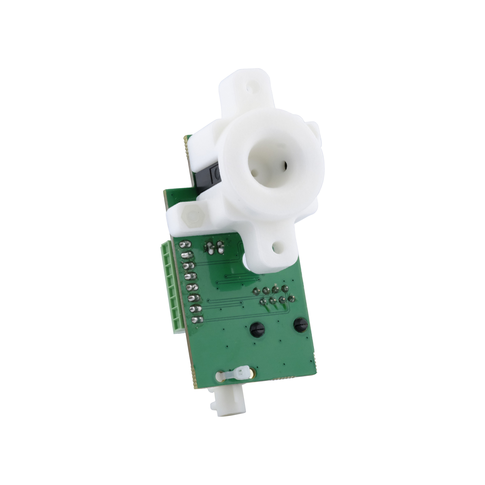

# Mice Poke

The Harp Behavior Mice Poke is a peripheral for the Behavior board that has onboard cue LEDs, detects pokes with an infrared beam, and controls a solenoid valve for reward delivery. Refer to the [connections](../connections.md?tabs=poke#connections) article to set up the peripheral and the [Control Poke Peripheral](../control-poke.md) article to use it in Bonsai.

{width=450}

## Key Features

- Plastic nose-poke enclosure for mice.
- Infrared beam poke detection.
- Control of 2 onboard LEDs, with the option of connecting an external LED.
- 12 V solenoid valve control for reward delivery.

## Specs

- Poke entry dimensions: 12 mm opening diameter, 7.5 mm ending diameter, 10.6 mm depth
- Recommended valve tubing: 2.0 mm inner diameter FEP or 2.1 mm inner diameter PTFE
- Connector: RJ45 for direct connection with the Behavior board poke port
- Alternative interface: Screw terminals for operating the peripheral with other external devices
    - 1x Digital Input / Output (DIO1)
    - 1x Infrared LED (IR LED)
    - 1x Infrared photodetector (IR PHT)
    - 1x Cue LED (LED)
    - 1x 5 V supply (+5V)
    - 3x Ground (GND)
    - 1x 12 V solenoid valve, terminal pair (VALVE)

## Hardware

| Version | Compatible Behavior Board | Notes |
| ------- | ------------------------- | ----- |
| 1.4 | > 1.0 | <ul><li> Updated valve footprint </li><li> Increased LED resistor</li></ul> |
| 1.3 | > 1.0 | <ul><li> Screw terminals consolidated into a single block </li><li> Added infrared beam and photodiode access on the screw terminals </li></ul> |
| 1.2 | > 1.0 | <ul><li> Initial version </li></ul> |

Assembled units are available from the [Open Ephys store](https://open-ephys.org/harp), or build your own using the hardware design files in the [Mice Poke](https://github.com/harp-tech/peripheral.micepoke) repository.

> [!NOTE]
> Three variants are available from the Open Ephys store, choose the right variant for your needs:
> - PCB only
> - PCB and mice poke enclosure
> - PCB, mice poke enclosure, and water valve

[!INCLUDE ]
