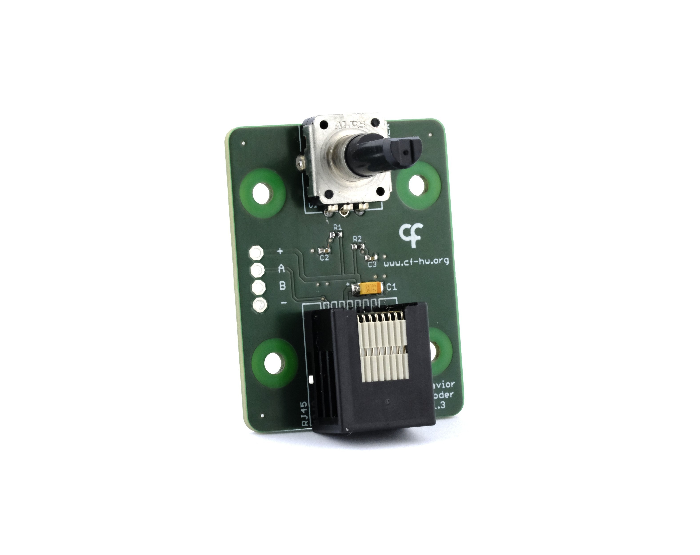

## Rotary Encoder

The Harp Behavior Rotary Encoder is a peripheral for the Behavior board that can be used to demonstrate how rotation can be tracked when the onboard shaft is rotated. It plugs directly into poke port **P2**, the only port with a quadrature counter. Refer to the [connections](../connections.md?tabs=encoder#connections) article to set up the peripheral and the [Track Rotary Encoder](../track-rotary-encoder.md) article to use it in Bonsai.

{width=450}

> [!NOTE]
> The Harp Behavior Rotary Encoder is meant to demonstrate simple rotational tracking. For applications in which high resolution tracking is needed, such as a running wheel, use a more precise quadrature encoder connected with the Harp Behavior [Breakout](https://github.com/harp-tech/device.soundcard).

### Key Features

- Onboard quadrature rotary encoder.
- Solder pads provide access to the encoder signals for use with external devices.

### Specs

- Encoder: Alps Alpine EC12E24204A9 (mechanical, 24 pulses per revolution, with detents)
- Connector: RJ45 for direct connection to a Behavior board poke port
- Solder pads: for wiring an external quadrature encoder or operating the peripheral from another device
    - 1x 5 V supply (+)
    - 1x Quadrature channel A (A)
    - 1x Quadrature channel B (B)
    - 1x Ground (-)

### Hardware

| Version | Compatible Behavior Board | Notes |
| ------- | ------------------- | ----- |
| 1.3 | > 1.0 | <ul><li> Fixed encoder direction </li></ul> |
| 1.2 | > 1.0 | <ul><li> Replaced the optical encoder with an Alps Alpine EC12E24204A9 mechanical encoder </li><li> Added pull-ups and filtering on the quadrature channels </li></ul> |
| 1.0 | > 1.0 | <ul><li> Initial version, using a Bourns ENC1J-D28-L00128 optical encoder (128 pulses per revolution) </li></ul> |

Assembled units are available from the [Open Ephys store](https://open-ephys.org/harp).

[!INCLUDE ]
