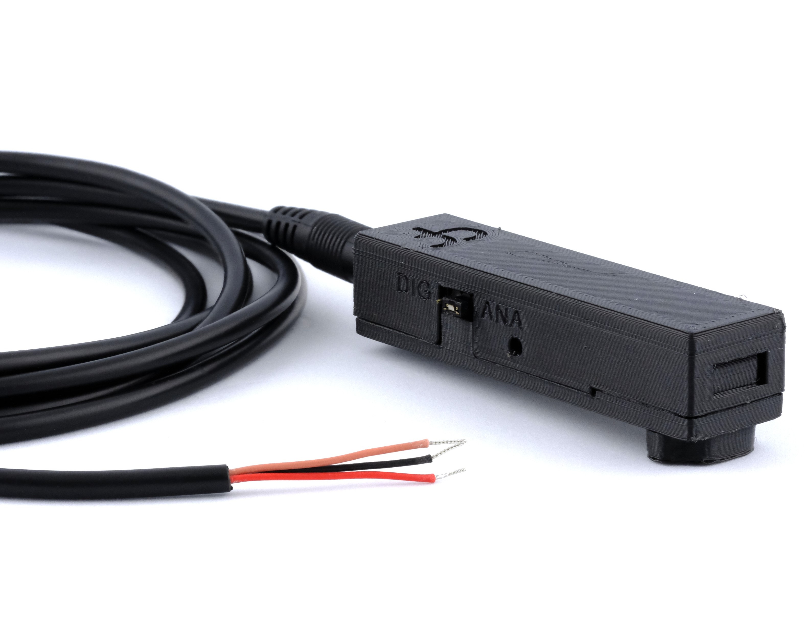

# Photodiode

The Harp Behavior Photodiode is a peripheral for the Behavior board. It detects light and outputs either an analog signal proportional to light intensity or a digital pulse when a configurable threshold is crossed, for instance to detect stimulus onsets on a screen. Refer to the [connections](../ports-connections.md?tabs=photodiode#connections) article to set up the peripheral and the [Acquire Analog Data](../acquire-analog-data.md) or [Read Digital Inputs](../read-digital-inputs.md) articles to read its output in Bonsai.

{width=450}

## Key features

- Blue-enhanced silicon photodiode.
- Switch between analog output (**ANA**) or digital output (**DIG**).
- Adjustment screw to set the threshold for digital output.
- Powered from the Behavior board's 5 V supply.

## Specs

- Photodiode: Advanced Photonix PDB-C156
- Connector: 3.5 mm stereo jack for stereo plug cable carrying 5 V, ground, and signal wire

## Hardware

| Version | Compatible Behavior Board | Notes |
| ------- | ------------------------- | ----- |
| 2.3 | > 1.0 | <ul><li> Initial version </li></ul> |

Assembled units are available from the [Open Ephys store](https://open-ephys.org/harp). 

[!INCLUDE ]
