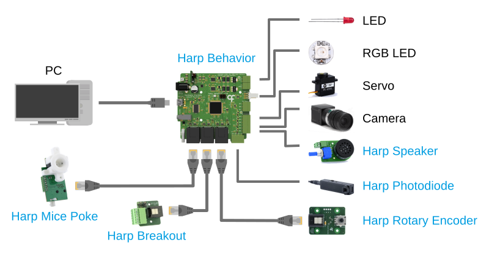

# Overview

The Harp [Behavior](articles/behavior-overview.md) board is a multi-purpose data acquisition and control device for behavioral neuroscience experiments.

A typical behavioral rig combines sensors, cue lights, reward valves, cameras and motorized actuators. These components usually need individual control interfaces and alignment to a common timeline. The Behavior board brings them together on a single device, so that every input and output stream is controlled through one interface and timestamped on the same hardware clock.

The Behavior board provides:

- Support for over 15 sensors and actuators which can be combined in real-time, e.g. to precisely time delivery of visual and auditory cues, motion and water rewards to timing of events such as nose pokes or running wheel position.
- Plug-and-play mice pokes designed to provide light cues and water delivery capabilities with little additional setup (no soldering required!)
- Seamlessly synchronize cameras and monitors with your behavioral arena.
- Easily control servo motors, RGB LEDs, and other devices directly, thanks to integrated control circuitry.
- Hardware timestamping and synchronization with other [Harp](https://harp-tech.org/articles/about.html) devices.
- [Bonsai](https://bonsai-rx.org/) integration for flexible experiment acquisition and control.

## Getting a device

Assembled units are available from the [Open Ephys store](https://open-ephys.org/harp), or build your own using the hardware design files in the [Behavior](https://github.com/harp-tech/device.behavior) board repository. Once you have a board, follow the "Getting Started" section to [set up the device](./articles/connections.md) and install the [software](./articles/installation.md).

## Acknowledgments

Hardware design and GUI contributed by [Champalimaud Foundation](https://www.cf-hw.org/), Bonsai interface by [NeuroGEARS](https://neurogears.org/), testing and feedback by [Allen Institute for Neural Dynamics](https://www.allenneuraldynamics.org/), and documentation by [Open Ephys](https://open-ephys.org/).

[!INCLUDE ]
